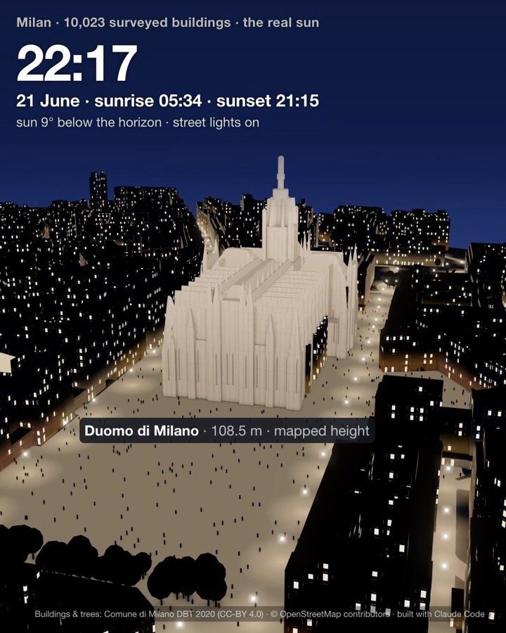
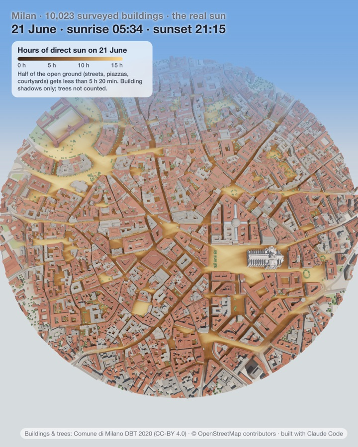
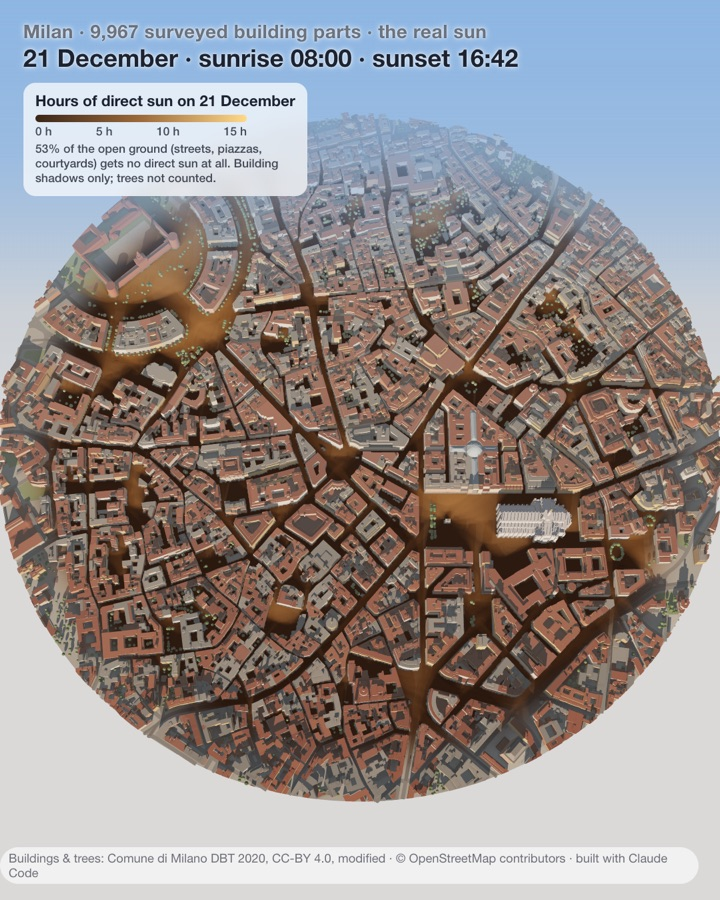

# Milan in 3D, lit by the real sun

Central Milan in the browser: 9,967 building parts from the Comune di Milano's own survey, 1,298 surveyed trees, the 11 tram
lines that cross the centre with trams running on them, people in the piazzas, and street lights hung over the streets as
in Milan. The sun is the real one for any date and time, from the blue hour before sunrise to the floodlit Duomo at night.

**Live:** https://mys1erious.github.io/3d-city-milan/



## What you can do
- Drag the time slider, pick a date (21 Jun / 21 Dec / today), orbit and zoom.
- Hover or tap a building for its name and surveyed height.
- **☀ Sun hours**: how many hours of direct sun every 2 m of street, piazza and courtyard gets on 21 June, 21 December
  or 20 March. Hover or tap a street for its number. On 21 December, 53% of the open ground in the centre gets no direct
  sun at all; on 21 June half of it gets more than 5 h 20 min.

| 21 June | 21 December |
|---|---|
|  |  |

## URL parameters
| Parameter | Effect |
|---|---|
| `?play` | the 26 s day-to-night flyover on 21 June (`&date=YYYY-MM-DD` for another day) |
| `?clean` | hide the controls |
| `&t=SEC` | freeze the flyover at that second |
| `?cam=tx,ty,th,az,el,d&m=MIN&date=...` | a still: camera target in m (x east, y north from the centre), height, bearing and elevation in degrees, distance in m, and the clock in minutes |
| `&heat` | open the sun-hours layer |

## Data
| Source | Used for | Licence |
|---|---|---|
| [Comune di Milano, Database Topografico 2020](https://dati.comune.milano.it/dataset/ds2889_database-topografico-dbt-2020-shp) (layers `UN_VOL`, `ALBERO`) | building volumes and heights, trees | [CC-BY 4.0](https://creativecommons.org/licenses/by/4.0/), modified: clipped to a 1.6 km disc and merged with OSM |
| [OpenStreetMap](https://www.openstreetmap.org/copyright) | the Duomo's spires, roof shapes (Galleria, Torre Velasca, Castello towers), names, streets, piazzas, parks, tram routes | ODbL, © OpenStreetMap contributors |

Inside the disc the survey has 10,899 building volumes, each with its height and base level, so arcades and raised wings
start above the street. The Duomo is the survey's own 64 volumes (nave 46.7 m, aisles 32.4 m, tiburio 65.8 m, spire
shaft 94.3 m, its pinnacles); OpenStreetMap adds the spire tip and the gilded Madonnina (108.5 m) and the tagged roof
forms (Galleria, Ottagono, Torre Velasca, the Castello's towers). For the 15 named buildings that have an OSM height,
the survey's tallest volume differs by 3.2 m at the median.

`landmarks.py` adds what neither dataset expresses: the Galleria's covered streets open under glass vaults from 25.07 to
29.28 m, the Ottagono's glass dome from 20.15 to 47.08 m, and the four entrances cut through the buildings in front (the
arch on Piazza del Duomo 12 m wide, open to 27.8 m, attic to 38.5 m), from A. Rondello's figures published by
[Politecnico di Milano](https://re.public.polimi.it/bitstream/11311/1006962/1/GVE%20volume%20OS%202016.pdf);
Palazzo della Ragione on its arcade of 7 x 2 arches (8 m height estimated); the Loggia degli Osii's portico (6 m,
estimated); the Vittorio Emanuele II monument (14.8 m, position from
[it.wikipedia](https://it.wikipedia.org/wiki/Monumento_a_Vittorio_Emanuele_II_(Milano)), footprint estimated); the
Teatro alla Scala's name; and only the top 4.16 m of the Madonnina gilded.

`roofs.mjs` gives the surveyed buildings their roofs: the DBT heights stop at the eaves, so each footprint gets its
straight skeleton from CGAL through [`straight-skeleton`](https://github.com/StrandedKitty/straight-skeleton) 2.0.1
(5,691 of 5,722 footprints), and the page builds a 17.7° tiled hip roof on it, at most 2.6 m high, or leaves a flat
terrace for the grey-roofed ones. The Torre Velasca gets its 20 ribs and struts in the page.

## How it works
- One `index.html` with three.js 0.170 from a CDN: extruded buildings, a façade shader (Milan's stucco colours, windows
  with shutters that light up at night), GTAO contact shadows, bloom, ACES tone mapping.
- **Sun**: NOAA solar-position formulas, checked against astronomy-engine 2.1.19: solar noon altitude in Milan is 31.36°
  on 28 Oct 2026 and 67.98° on 21 Jun; the worst difference over 2026 is 0.02°.
- **Sun hours** (`data/sun_hours.py`): for every 5 minutes with the sun up, a ray from each 2 m cell, 1 m above the
  ground, marches towards the sun over a height grid of the buildings. Trees are not counted. Buildings outside the disc
  are missing, so the page fades the outer 140 m and the numbers above use the inner 660 m.

## Rebuild the data
```sh
cd data
# 1. buildings and trees from the Comune's DBT 2020 shapefiles (597 MB zip, unzip the "DBT 2020 - SHAPE" folder)
uv run --with pyshp --with pyproj python dbt_merge.py "<DBT 2020 - SHAPE dir>" milan-osm.json milan.json
# 2. tram routes and piazzas from Overpass (out geom), within 830 m of 45.4662, 9.1868
python3 -I add_trams.py trams.json milan.json      # relation["route"="tram"]
python3 -I add_piazzas.py squares.json milan.json  # highway=pedestrian / area:highway=pedestrian / place=square
python3 -I landmarks.py milan.json scala.json      # Galleria, arcades, monument, La Scala (relation(6552704);out geom;)
node roofs.mjs milan.json                          # needs: npm i straight-skeleton@2.0.1 @playwright/test
# 3. sun hours
python3 -I sun_hours.py milan.json . 2026-06-21 2026-12-21 2026-03-20
```
`milan-osm.json` is the OSM snapshot of 2026-07-15 compacted by `prep.py`.
